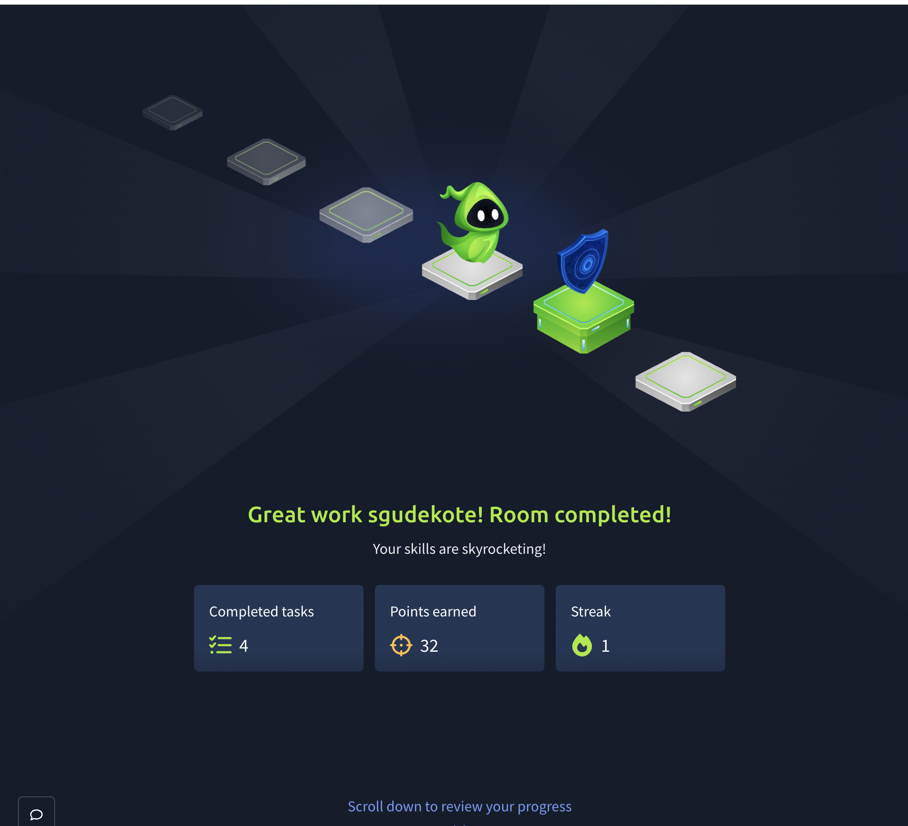

# Cyber Security Portfolio - ITECH1502

## About This Portfolio

This portfolio contains my experiential learning and activities as a part of the subject ITECH1502 Cybersecurity Fundamentals at Federation University.

The aim of this portfolio is to show my knowledge of information security terms, security weaknesses, ethical hacking and how important it is to secure information systems.

## Project 1. Offensive Security - TryHackMe

Platform: TryHackMe

Exercise: Offensive Security Intro

Date completed: 14 October 2026

Status: Completed (4/4 tasks)

### Project Overview

This was a beginner-level ethical hacking exercise completed using the Fake Bank website for the TryHackMe practice site. It showed how an attacker can find 'secret' pages on a website and abuse access controls.

### Objectives

- Be familiar with the fundamentals of offensive security.
- Find out how to perform directory scans with the DIRB directory-scanning instrument.
- Detect concealed pages on a bank site simulated.
- Showcase the threats of an open administrative feature.
- Learn real-world cybersecurity skills in an isolated lab.

### Methodology

1. Signed up for TryHackMe and selected the Offensive Security Intro exercise.
2. Launched the Fake Bank app within the simulated virtual desktop.
3. I was able to locate the account number on the bank website.
4. Terminal was opened and ran dirb http://fakebank.thm.
5. Reviewed the scan results and found the page that was /bank-transfer.
6. Entered the admin transfer page and tried a fake deposit.
7. Confirmed the exercise outcomes and successfully finished four trials.

### Results

The DIRB scan yielded two of the website locations '/images' and '/bank-transfer'. The second location revealed a 'mock' administrative banking function.

The exercise showed how an administrative page that was not secured well enough would be a security risk.

Completion: 4/4 tasks, 32 TryHackMe points earned.

### Reflection

I learned how security flaws can be exploited by unethical hackers before genuine attackers do. I learned how to use a text-boxed program to uncover mysteries from a website and reason that administrative functions and access should be highly safeguarded.

The activity has also highlighted that the vulnerability can be mitigated by ensuring sensitive website functionality is protected through authentication and authorisation, instead of just hiding away in a URL.

In future activities I would like to further my knowledge on Vulnerability assessment, Penetration testing and how to build a secure website.

### Tools and Technologies

- TryHackMe
- DIRB directory scanner
- Linux terminal
- Mozilla Firefox
- Fake Bank replica bank app

## Evidence of Practical Work

### Screenshot 1: DIRB Directory Scan

This screenshot is part of DIRB scan results when you have two directories /images and /bank-transfer identified by it. This is how you can use directory scanning to discover hidden pages of a website.

### Screenshot 2: FakeBank Deposit

This screenshot demonstrates a failed deposit through the administrator page of the test bank. Shows how weak access controls lead to security issues.

### Screenshot 3: TryHackMe Completion

From this screenshot we can see I've finished the TryHackMe Offensive Security Intro exercise and received a total of 32 points after completing all four challenges.
